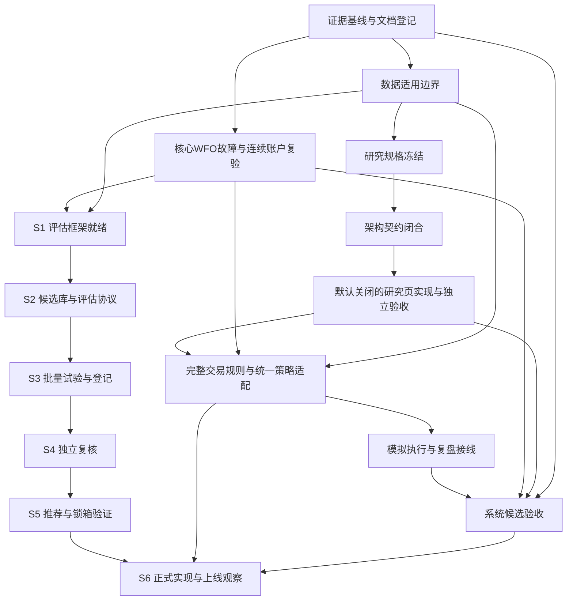

# 风险、依赖与未知登记

版本 v0.8；2026-11-06；维护：总体规划负责人。变更：v0.7 据三份回执与 23:16 磁盘复核更新 R16（36 次试验、`n_trials` 记 12 而非 36）、R17（924 日已被 36 次试验消耗）、R18（研究侧账本与生产库脱节）、R21（研究员回执与磁盘矛盾升级），并新增 R22（四项数据边界使「稳定盈利」宣称档不可达）；v0.6 更正 R15 一处归属、按 27 次试验更新 R16/R17/R20 并新增 R21；v0.5 新增 R20 并据用户确认更新 R16/R17 控制条件；v0.4 依 22:36–22:38 核心文件改动更新 R13/R14。逐条证据见 EVIDENCE.json。 v0.8 新增 R23（协议事后补写）、关闭 C12 口径分歧、更正 C13（S07 全期回撤 -29.93%）。

| ID / 级别 | 实际证据与影响 | 责任角色 / 依赖 | 解除或控制条件 | 当前状态 |
| --- | --- | --- | --- | --- |
| R01 / P0 | 独立审核 R1：`GET /api/backtest/walkforward/stream` 返回 500，放开异常为 NameError；Ruff 两处 F821；影响 WFO 成功路径 | 原修改维护者修复、开发集成、独立审核复验；G1-02、G1-04 | 参数完整透传；F821 消除；正常 API/SSE 成功与失败路径测试；版本摘要对应实测 | **修复候选待复验**。22:37:58 的 `api/backtest.py`（64,373 B，`6cd4e01d…`）第 1373 行已声明 `continuous_account: bool = True`，第 1455/1518 行透传；规划方未跑 Ruff 或 TestClient，F821 是否已清零无实测证据 |
| R02 / P0 | coverage_report.json verdict=anomaly_detected、exit_code=1；证券快照完整性及行业 PIT 日历/深度失败，证券生命周期 unknown | 数据工程师 / G1-01 | 修复并重审对应检查；不能修复时收窄研究范围并保留 unknown，严格历史验证继续阻断 | 开放；修正版报告已读 |
| R03 / P0 | 修正后 daily_cross_section_backtest.supported=false、permitted_use=exploratory_research_only；616证券无复权因子、43,503缺失证券日、241证券提前停止；无停牌/退市表，无成交可行性审计 | 数据、研究 / G1-01、G4-01 | 逐项给可验证历史资料或保留限制；不得用当前证券池/行业回填历史，不能把一致性检查当完整可用性结论 | 开放；只准带完整限制的探索。**S 线直接受影响**：任何跨截面或行业条件下的「稳定」结论都受此限制 |
| R04 / P0 | 核心 engine/strategy/walkforward/API 及前端有未提交修改；独立审核 22:18 结论为阻断验收、确认 3 项 P1 | 开发/研究修复、独立审核复验 / G1-03、G1-04 | 连续/重置语义、跨折现金持仓挂单费用守恒、日期轴与缓存兼容全部按确切版本验收；三项 P1 逐项关闭 | **阻断持续，但证据基线已变**：三份核心文件在 22:36:55–22:37:58 被改动（`api/backtest.py` `769a0cfa…`→`6cd4e01d…`；`walkforward.py` `ec4b8d5b…`→`bde5da93…`；`engine.py` `2b650ca9…`→`b1766c08…`），且 `engine.py` 于 22:45:42 再变为 268,504 B / `efe55703…`。审核结论尚未被任何复验推翻或确认。规划方未复跑其探针，也未逐行对比 22:45:42 的 diff |
| R05 / P1 | 威科夫接入设计和架构提案均把精确规则/冻结样本列为必需；本轮未定位实物规格 | 量化研究员 / G2-01 | 提供规格路径、版本与逐日期望输出；架构按规格闭合；不得由规划/开发猜阈值 | unknown，阻断正式规则实施 |
| R06 / P1 | 架构师发现 StockDailyKChart 独立取数和 kline.py 实时追加行不受历史 end 约束，空集回源也有风险 | 架构师契约、开发实现、审核验证 / G2-02、G3 | 首版研究接口返回同源 candles 与事件；或先独立补可验证共享快照能力；覆盖有数据/空集/盘中行/历史日期测试 | 已有设计控制，尚未实现 |
| R07 / P1 | generation 可为 None；没有证明历史复权与发布时间存档 | 数据、架构、研究 / G2-02 | 未知版本显式不可复现；区分当前版本回放与真实历史时点验证；版本更换不得复用旧缓存 | 开放 |
| R08 / P1 | 独立复盘工具仅验证关联和股数；不验证价格、费用、现金、持仓正确性；同账户一致导出、拒单决策信息未接线 | 复盘工程师、开发、架构 / G4-02 | 按服务锁顺序生成一致快照，账户隔离；稳定决策ID及 outcome/请求数量/参考价/原因/输入版本；历史缺失保持unknown，账务另验 | 工具已交；系统集成未完成 |
| R09 / P1 | git 状态包含行业链 service.py、AnalysisPanel.tsx 删除及多个公共文件变动；修改归属不能由状态确定 | 开发协调维护者；总体规划记录 / 所有实现阶段 | 每次写入前复读 diff，限定文件、保存摘要；确认删除目的和兼容性；不搬删他人成果 | 开放，不主动清理 |
| R10 / P1 | 架构/开发报告 git diff --check 指向 test_industry_chain_extension.py:808 EOF 多余空行 | 原修改维护者 / G5 | 原维护者处理，并对待验版本复查；本规划不改其文件 | 报告中的既有问题，本轮未修 |
| R11 / P1 | 全系统回归、浏览器联调、当前运行生效版本、真实通知/执行未由本轮验证 | 开发提供工程证据，独立审核给结论 / G4-03、G5 | 在确切候选版本验证完整用户流程、失败与兼容、构建/类型及相关性能；发布前记录回退，不把源码存在当运行生效 | 未验证 |
| R12 / P1 | 设计提案、现行文档与研究报告混用可能夸大完成；docs 既有多份历史计划 | 文档管理员 / G0-02，规划协作 | 索引区分类型/状态/版本/维护者和替代关系，链接真实文件；缺回执不称已登记 | v0.2 已登记并经规划方只读重算 102 条摘要一致（漂移 0）；正文升 v0.4 后待重登记 |
| R13 / P0 | 独立审核 R2：结转时 `entry_time_id` 重置为 -1，持有日按 `time_id - entry_time_id + 1` 计算，导致 HoldExtensionPolicy 退出日 01-08→01-10、duration 5→7 | 原改动维护者/开发修复；独立审核复验 / G1-03、G1-04 | 改用可跨段累计的交易日年龄或显式全局偏移；统一开/收盘入场包含关系；补逐笔/费用/现金/期末权益跨切割等价用例 | **修复候选待复验**：`engine.py`（22:45:42，268,504 B，`efe55703…`；v0.4 记为 `b1766c08…`/268,176 B）第 4168–4173 行按 `hold_session_age` 计算持有日，并注明随 `carry_state` 结转不清零、旧实现用 `time_id − entry_time_id` 会低估持有日；第 2682 行 `entry_time_id=-1` 仅作「无本段信号行」标记，结转时按 `hold_days + 1` 兼容补 `hold_session_age`。等价性无实测；跨折+延展+止损+待执行订单组合未验 |
| R14 / P0 | 独立审核 R3：`walkforward.py:48` 仅拒 `step_days < test_days`，允许间隔窗；`:403` 只回放 optimized 测试窗；缺口交易日跳过持仓管理，01-06 缺失、漏 stop_loss，期末权益 99,993.70 vs 完整回放 95,490.55 | 开发修复；独立审核复验 / G1-03、G1-04 | 先拒绝连续模式下 `step_days != test_days`；训练失败成缺口时明确停止/拒绝；若确需间隔窗须定义缺口内参数并逐日回放；加账户日期完整覆盖检查与含缺口止损/待执行订单/中间训练失败反例 | **修复候选待复验**：`walkforward.py`（39,556 B，`bde5da93…`）在 API 第 1416 行起于连续模式下对 `step_days != test_days` 直接报错；`generate_folds` 仍只拒 `step_days < test_days`（离线/重置口径）。缺口内止损与中间训练失败反例未见新增证据 |
| R15 / P1 | 文档管理并发写入：22:18–22:21 观察到非管理员本人的改动；22:39:35 `docs/README.md` 变更为 6,972 B / `cd66113d…`——**该次已由文档管理员认领为其 v0.3 轮同步，不属第三方**；22:52–22:56 `CATALOG.md` 出现 v0.5 内容，写入方仍未明 | 文档管理员统一为单一写入者；总体规划只保证本目录正文稳定 / G0-02 | 指定唯一写入者；写入后重跑 check.py 并留回执；冲突时保留他方改动再叠加，不整文件还原 | 开放但收窄：22:39:35 的归属已澄清；剩余不确定为 `CATALOG.md` 22:52–22:56 与非管理员所加的 `docs/README.md` 第 34 行。规划方未重跑 check.py（管理员 23:00:57 实测 EXIT=0、107 条、漂移 0） |
| R16 / P0 | **搜索污染**：同一段历史被反复用于筛选、调参、事件修正后不再是样本外。仓库已有先例——T74 `+331.04%` 依赖 73,853 条事后 allowlist；连续账户 `+23.08%` 受参数与事件选择污染。**今晚实证升级**：首轮 36 次公开策略试验（12 策略 × 10/30 bps/gross）已把 2023-01—2026-10 这 924 个交易日的 OOS 用掉；研究侧虽已算 DSR，但 `n_trials` 取 12 而实际执行 36，校正偏松；最高 DSR 0.027（S07） | 研究员定协议与阈值；开发在 S3 累计 `n_trials`；总体规划只登记 | 协议冻结后开跑；`n_trials` 由系统累计并覆盖全部成本情景与参数组；OOS 段一旦被使用即登记为已消耗 | 开放且已发生：36 次试验已消耗 OOS，`n_trials` 低估（12 vs 36） |；v0.8 补：`PROTOCOL.md` §8 明示成本档不计入 N，12 与 36 之差属口径而非漏计（C15）。
| R17 / P1 | **锁箱治理**：一次性前瞻样本若被提前查看、反复启封或事后改口径，则失去证据效力；已有 `auction-lockbox-20261101/PROTOCOL.md` 的先例但仍在等待数据 | 研究员定义协议；文档管理员登记启封记录；独立审核核验 | 启封条件、时点、判读规则事先登记；只开一次；结果正负均登记；启封前不得有人查看该段数据；用户已确认锁箱 ≥60 交易日；研究员建议改 ≥120 交易日（待定稿） | 开放且**已受损**：2023-01-02–2026-10-30（924 个交易日）已被 36 次试验消耗，不能再充当 S5 锁箱；须另划未动用时段或改用前瞻锁箱 |
| R18 / P1 | **试验账本与算力**：生产侧无跨策略批量编排与统一试验登记——`candidates.py` 上限 200 条、字段无 `params_hash`/`data_version`/`cost_scenario`/`n_trials`，不能充当试验账本；研究侧 `results/registry.json` 是可读雏形（有 `meta`、逐 run 指标、`summary.json` 的 DSR），但与生产库无关联、`n_trials` 记 12；批量试验的时间与内存预算未测 | 开发实现编排与登记册；研究员定试验设计；总体规划记录资源约束 | 报告任一数字可反查到唯一试验记录与指纹；失败/重复试验不静默丢弃；`n_trials` 覆盖全部成本情景与参数组；批量运行时长与内存有实测上限 | 缺口未补；无性能数据；两侧账本尚未合一 |
| R19 / P1 | **公开策略来源与移植口径**：公开策略常含不可移植假设（固定 9.5% 涨停、倒序 EMA、按机器当前时间过滤），且来源版本、许可与引用需固定 | 研究员负责来源与规格；行情数据给可用宇宙；开发负责移植实现；独立审核核验口径 | 每条候选记录来源仓库与提交号、许可、原规则与移植差异；涨停/涨跌停按本项目规则；指标计算方向经正反样例验证 | 已有盘点（khunter-feasibility-20261105，12+8 个策略、3 处缺陷）；S 线清单未建立 |

| R20 / P0 | **判定口径与可达性分歧**：用户已确认的口径（锁箱 ≥60 交易日、MDD ≤20%、BH-FDR q<0.1 或 DSR≥0.95 均保留）与研究员的方法判断冲突——研究员认为四项数据缺口未补齐前「样本外稳定盈利」不可达，且门槛叠加会形成 S5 长期不可交付 | 研究员出定稿文件；用户再次确认口径变更；独立审核复核判定流程；总体规划只登记不裁定 | 两条路径只允许其一：（a）维持已确认口径，接受「可能长期无候选通过」并以负结果收口；（b）研究员出定稿文件说明改口径的技术理由，经用户确认后在 DELIVERY-CHECKLIST 留变更记录。禁止规划、开发、审核自行降低门槛 | 开放，且首轮实证已指向研究员的判断：36 次试验中 0 次样本内外同时为正；OOS 最大回撤只有 S07（-9.36%）、S12（-11.00%）、S11（-19.43%）在 20% 以内，其余 -21%～-84%；最高 DSR 0.027，远低于 0.95。这**加重**了「口径可能长期不可通过」的现实性，但**不构成**放宽依据——改口径仍需路径（b）。研究员另提出两档目标（门槛档可达 / 宣称档当前不可达），用户尚未选择，未生效 |
| R21 / P1 | **研究产物归属与协议缺位（矛盾升级）**：`research/strategy-search-20261107/` 于 22:45:54 出现，22:48–23:11 持续写入 36 组结果与 8 个脚本，但无 README / 候选卡 / `protocol.md`、无署名、`scripts/` 内 0 处来源引用或许可；研究员 23:11 回执称该目录 `Test-Path` 为 `False`、「未启动实验、未写任何文件」，与磁盘同期状态直接矛盾 | 量化研究员（产物与规格署名）；文档管理员登记；总体规划只记录不推断作者 | 产物须有作者、来源、协议与数据可用性判定；无协议的结果一律标探索性；未登记产物不得进入 S4 复核材料；矛盾由研究员与文档管理员各自出证据澄清 | 开放且**矛盾未解**：磁盘有 81 个结果文件，回执称目录不存在 |
| R22 / P0 | **数据边界使「稳定盈利」宣称档不可达**：研究员列明四项缺口——`daily_cross_section_backtest.supported=false` 使全市场横截面研究不成立、616 只证券无复权因子使分红除权污染收益、无停牌/退市表使可成交性与幸存者偏差不可检验、行业 PIT 仅 6 天使行业中性化无意义；四项任一未补齐，其验收口径下的「稳定盈利」结论都不成立；研究侧 `data_boundary.json`（23:16:28）已量化面板缺口 34,014 个证券 × 交易日（0.53%）、181 只提前断档，但停牌 / 退市表、复权因子、行业 PIT 仍未提供。36 次试验 0/36 与该判断方向一致，但负结果不能证明「不存在正 alpha」 | 行情数据工程师补复权/停牌/退市/PIT；研究员出规格并标 unknown；总体规划只登记 | 四项补齐并出数据版本后，才允许使用「宣称档」措辞；在此之前 S5 只按用户已确认的门槛档判定，对外表述限定为数据边界内的结论 | 开放；四项均未补齐 |
| R23 / P1 | **协议事后补写**：`PROTOCOL.md` 23:25:33、`STRATEGIES.md` 23:22:30、`README.md`/`CAPABILITIES.md` 23:25:33，全部晚于首个 run 22:51:55；`PROTOCOL.md` 原文自称「任何回测运行之前写入」，与时间戳矛盾；`STRATEGIES.md` 全文无外部来源链接 | 「预注册」不可证，事后调门槛的风险无法从文件本身排除，S2 放行证据失效 | 文档已写入，无需重跑即可读；以「先落协议、后跑」的 mtime 为唯一有效证据 | 本轮只记事后文档，S2 门槛维持未达；独立审核可按 mtime 复核 |

## 依赖图与分流

图中的数据适用边界可为「明确受限探索」；它不等于严格历史可用性通过。研究页路线与核心 WFO 修复可并行，后续交易适配仍受核心与数据适用门槛约束。S 线可并行搭建 S1/S2，但 S3 起的绩效结论必须等 G1-04 关闭；S6 同时受 G4-01/G4-02 约束。

## 待核实项及应提交的证据

| 未决事项 | 收敛责任 | 需要的实物 |
| --- | --- | --- |
| 三项 P1 的修复正确性 | 独立审核（修复由开发完成） | 修复差异、跨折+延展+止损+待执行订单的逐笔/费用/现金/期末权益等价实测、Ruff 与成功路径实测、复验结论 |
| continuous_account 阻断复验 | 独立审核 | 已落盘 REVIEW.md（SHA-256 `73ab7d81…`，§4 列解除条件）；仍缺复验报告 |
| 数据缺口能否修复或哪些研究范围被正式限定 | 数据工程师与研究员 | 数据版本、缺口归因材料、可用范围及 unknown 清单 |
| 威科夫规格是否已交及版本 | 量化研究员 | 精确规格及冻结输入/逐日期望输出路径；不能只交研究描述 |
| S 线候选库是否已交付 | 量化研究员 | 目录、8 个脚本（`common.py` 25,080 B / 23:07:02 等）与 81 个结果文件已落盘（12 策略 × 3 成本档 = 36 次，`registry.json` 175,133 B / `2597d6fa…`，23:16 复核）；仍缺候选卡、`protocol.md`、来源与许可登记；研究员回执称目录不存在，与磁盘矛盾（R21） |
| S 线试验登记与批量编排 | 系统开发工程师 | 跨策略批量入口、登记册 schema、`n_trials` 累计与指纹；批量运行的时长/内存实测 |
| 「稳定盈利」判定标准 | 总体规划汇总，研究员定稿阈值 | 用户口径已于 2026-11-06 确认；仍缺研究员定稿文件、独立审核对判定流程的复核、对两档目标（门槛档/宣称档）的用户选择 |
| 本目录 v0.7 的登记回执 | 文档管理员 | 按 v0.7 摘要登记 4 份文件；v0.6 已于 23:09:45 登记（109 条、`check.py` 退出码 0、漂移 0），v0.5 及更早均已入 `superseded_versions`，替代链完整 |
| 当前运行版本及用户流程是否与源码一致 | 开发、独立审核 | 候选版本和运行版本标识、端到端结果；本轮不重启或部署 |

## 状态更新原则

只更新本独立规划目录。架构师、研究员和审核员的新结论先读取实际文件再引用；矛盾需原责任角色出修正证据。独立审核结论只按其原文引用，注明路径与摘要；本规划不复跑其探针、不改写其判定，也不把「已修复」写成「已验收」。旧证据保留来源及失效理由，不用一次新的测试数覆盖旧业务风险。阶段通过应具备交付物、限定范围的实测与独立验收，任何一项未知仍按其影响保留限制。工作区文件摘要在并发写入期间会移动，凡引用摘要必须标注读取时点。
